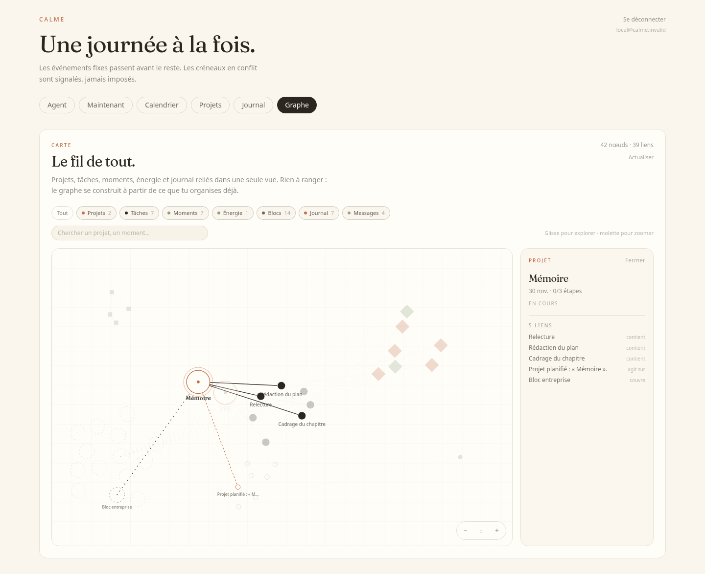
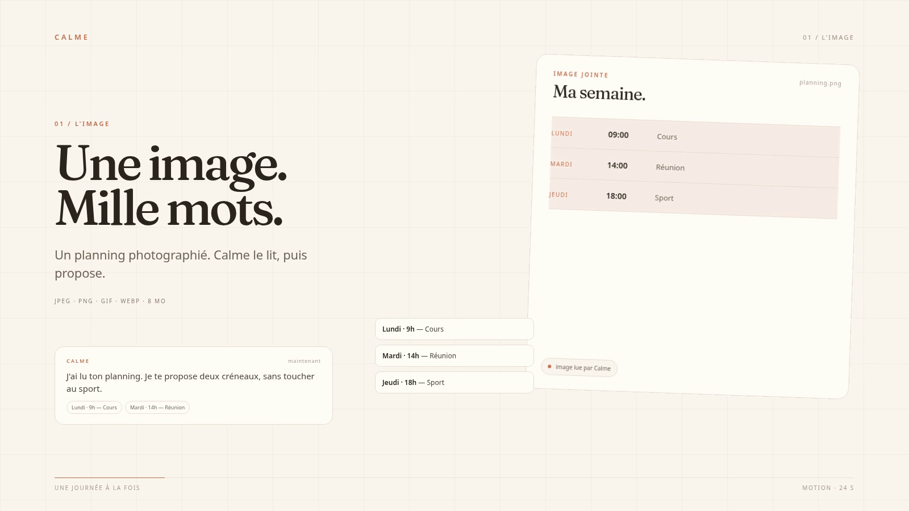
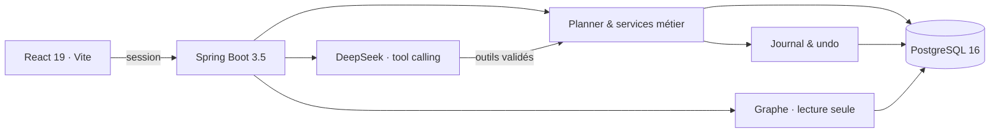

<div align="center">
  
</div>

<div align="center">
  <a href="https://github.com/khadimmbaye0/calme/actions/workflows/ci.yml"></a>
  <a href="https://github.com/khadimmbaye0/calme/actions/workflows/validate-fixtures.yml"></a>
  
</div>

<div align="center">
  
  
  
  
  
  
</div>

<p align="center">
  <strong>Planifier moins. Garder de la marge. Respirer.</strong><br>
  <sub>Un agent central, un calendrier qui protège les engagements, et une seule chose à la fois.</sub>
</p>

> **MVP local fonctionnel** — calendrier, « Maintenant », projets, journal, agent DeepSeek, graphe de connaissance et lecture d’images. Le digest, la replanification avancée et l'évaluation des variantes de commandes restent ouverts.

---

## Le film


<p align="center"><sub>24 secondes, une bande sonore originale — <a href="docs/videos/calme-motion.mp4"><strong>voir le film sonore</strong></a> · <a href="docs/MOTION.md">storyboard, son et fabrication</a>.<br>Le GIF est un aperçu muet ; le MP4 contient le son. Le film inclut la lecture d’une image.</sub></p>

---

## Aperçu


<p align="center"><sub>L'agent propose, le serveur valide, le journal garde une trace inversible.</sub></p>

### Le fil de tout



<p align="center"><sub>Projets, tâches, moments, énergie, blocs, journal et messages — dans une seule carte.</sub></p>

Le **graphe de connaissance** est une lecture de ce que Calme organise déjà. Il relie les projets à leurs tâches, les tâches à leurs dépendances et à leurs créneaux, les actions du journal à leur cible, l'énergie aux tâches reportées, et les blocs d'alternance aux dates qu'ils couvrent.

Filtres par famille, recherche, zoom, déplacement et détail au clic. Le graphe est **en lecture seule** : il ne crée aucune donnée et n'est jamais envoyé au LLM. Les relations et les limites sont documentées dans [`docs/GRAPH.md`](docs/GRAPH.md).

### Une image aussi



<p align="center"><sub>Extrait du film : une image lue, trois rendez-vous extraits, deux créneaux proposés.</sub></p>

Joins un planning, une capture d’écran ou une photo de tableau. L’agent lit les dates, heures et titres utiles, puis propose l’action d’organisation adaptée. Formats **JPEG, PNG, GIF et WebP**, **8 Mo maximum**. L’image est stockée avec la conversation et envoyée à DeepSeek pour être comprise.

### Calendrier, projets, journal et mobile

| Calendrier | Projets |
|:---:|:---:|
|  |  |
| **Journal** | **Mobile** |
|  |  |

<p align="center"><sub>Captures réalisées avec un jeu de données de démonstration.</sub></p>

---

## Ce que fait Calme

<table>
  <tr>
    <td width="50%" valign="top"><strong>Agent central</strong><br>Une phrase suffit. L'agent appelle des outils, le backend vérifie les règles, puis l'action est journalisée et annulable.</td>
    <td width="50%" valign="top"><strong>Maintenant</strong><br>Une seule action, 25 minutes maximum. L'énergie se déclare en un geste ; en énergie basse, les tâches non critiques sont reportées.</td>
  </tr>
  <tr>
    <td valign="top"><strong>Calendrier</strong><br>Vue jour, événements fixes, planifiés et disponibilités. Les conflits sont signalés avant écriture.</td>
    <td valign="top"><strong>Projets</strong><br>Objectif, échéance, étapes, dépendances validées en DAG et buffer de 20 % minimum.</td>
  </tr>
  <tr>
    <td valign="top"><strong>Journal & contrôle</strong><br>Les 30 dernières actions sont visibles, expliquées et annulables. Les suppressions et les gros plans demandent confirmation.</td>
    <td valign="top"><strong>Graphe</strong><br>Tout ce qui est organisé, relié dans une carte calme. Une lecture, pas une nouvelle source de vérité.</td>
  </tr>
</table>

**Images** — un planning photographié, une capture d’écran ou une photo de tableau : Calme lit, extrait et propose.

---

## L'agent, sous contrôle

> **Vous** — Ajoute un cours demain de 9h à 10h.
>
> **Calme** — C'est ajouté. Je garde la matinée libre après.

Le modèle **propose** des appels d'outils : calendrier, tâches, projets, énergie, Maintenant et journal. Le backend applique les règles de conflit, de capacité, de dépendance et de confirmation, puis journalise l'action avec son inverse. Le LLM ne touche jamais directement la base.

Une image peut remplacer un long paragraphe : joins un planning ou une capture, et l'agent la lit avant de proposer. Une seule image est envoyée par tour, et la dernière image de la conversation reste disponible pour la question suivante.

Sans clé, l'application démarre en mode `simulated` et ne fait aucun appel réseau. Pour le mode réel :

```bash
DEEPSEEK_API_KEY=<votre-clé>
CALME_LLM_MODE=deepseek
DEEPSEEK_MODEL=deepseek-flash
```

La clé reste dans `.env`, ignoré par Git. Le contrat complet est dans [`docs/AGENT_CONTRACT.md`](docs/AGENT_CONTRACT.md).

---

## Architecture



| Couche | Choix |
|---|---|
| Frontend | React 19, Vite 8, TypeScript 5.9, Tailwind CSS 4, Fraunces |
| Backend | Spring Boot 3.5, Java 21, Spring Security, Spring Data JPA, Flyway |
| Données | PostgreSQL 16, Testcontainers pour les tests |
| Agent | DeepSeek tool calling, mode `simulated` sans réseau |
| Déploiement | Docker Compose, Nginx, healthchecks |

---

## Démarrer

```bash
git clone https://github.com/khadimmbaye0/calme.git
cd calme
./scripts/up.sh
```

Le script crée `.env` si nécessaire, génère les secrets locaux, construit la pile, attend le healthcheck et affiche l'URL ainsi que le mot de passe Calme à la première génération.

Ouvrir **<http://localhost:5173>**. Compte local : `local@calme.invalid`.

```bash
make up                  # équivalent
docker compose down
docker compose down -v   # supprime aussi les données locales
```

Seul le port frontend est publié ; PostgreSQL et Spring restent sur le réseau Compose. Le port `FRONTEND_PORT` vaut `5173` par défaut.

<details>
<summary>Développement manuel</summary>

```bash
cp .env.example .env
# renseigner POSTGRES_PASSWORD et CALME_AUTH_PASSWORD
docker compose up --build -d
```

Pour lancer PostgreSQL depuis l'hôte :

```bash
docker compose -f compose.yaml -f compose.dev.yaml up -d db
set -a && source .env && set +a
cd backend && mvn spring-boot:run
```

Frontend en développement :

```bash
cd frontend
npm ci
npm run dev
```

L'API détaillée et les exemples `curl` sont dans [`docs/API.md`](docs/API.md).

</details>

---

## Sécurité et données

- Session locale, mot de passe BCrypt, cookie `HttpOnly` et `SameSite=Strict`.
- CSRF désactivé pour cette application locale non exposée ; à revoir avant toute mise en ligne.
- Pas de 2FA, pas de TLS, pas de sauvegarde automatique : ce n'est pas encore un déploiement de production.
- Les secrets restent dans `.env` (ignoré, mode `600`) et ne sont jamais intégrés aux images.
- En mode DeepSeek, le message, la date, le bloc, l'énergie, l'image jointe et les données nécessaires aux outils transitent par l'API. Pas de mot de passe, secret ou donnée d'entreprise.
- Les images sont limitées à 8 Mo, validées par leur contenu réel (JPEG, PNG, GIF, WebP), stockées en base et servies uniquement à la session authentifiée.
- Le mode `simulated` reste disponible pour développer sans réseau.

---

## Tests et qualité

| Suite | Commande | Résultat |
|---|---|---|
| Backend | `cd backend && mvn test` | **62 tests** |
| Frontend | `cd frontend && npm test` | **39 tests** |
| Build | `cd frontend && npm run build` | TypeScript + Vite |
| Fixtures | `python3 scripts/validate_fixtures.py` | Contrat et fixtures valides |

Les tests backend utilisent Testcontainers PostgreSQL ; les tests frontend Vitest et Testing Library. La CI vérifie chaque pull request, ainsi que GitGuardian.

---

## Roadmap

- [x] Socle Spring Boot, React et PostgreSQL
- [x] Authentification locale par session
- [x] Calendrier manuel et vue jour
- [x] Écran Maintenant et planner énergie
- [x] Projets, dépendances et buffer
- [x] Journal et annulation
- [x] Agent conversationnel DeepSeek
- [x] Graphe de connaissance
- [x] Interface minimaliste et responsive
- [x] Déploiement en une commande
- [ ] Digest quotidien
- [ ] Replanification et édition avancée des projets
- [ ] Import/édition des blocs d'alternance
- [ ] Évaluation des 20 variantes de commandes
- [ ] Rate limiting de l'agent et sauvegardes

---

## Documentation

| Document | Contenu |
|---|---|
| [`docs/PRODUCT_SPEC.md`](docs/PRODUCT_SPEC.md) | Spécification produit et périmètre MVP |
| [`docs/ACCEPTANCE.md`](docs/ACCEPTANCE.md) | Critères d'acceptation |
| [`docs/AGENT_CONTRACT.md`](docs/AGENT_CONTRACT.md) | Contrat de l'agent et outils |
| [`docs/API.md`](docs/API.md) | Exemples d'API |
| [`docs/GRAPH.md`](docs/GRAPH.md) | Graphe de connaissance, relations et limites |
| [`docs/DECISIONS.md`](docs/DECISIONS.md) | Décisions prises |
| [`docs/PLAN.md`](docs/PLAN.md) | Plan de livraison |
| [`docs/QUESTIONS.md`](docs/QUESTIONS.md) | Questions encore ouvertes |
| [`docs/DESIGN_TOKENS.md`](docs/DESIGN_TOKENS.md) | Palette, typographie et règles visuelles |
| [`docs/MOTION.md`](docs/MOTION.md) | Storyboard, son et fabrication du film |

<div align="center">
  <sub>Calme — projet personnel. Captures et film réalisés avec des données de démonstration.</sub>
</div>
