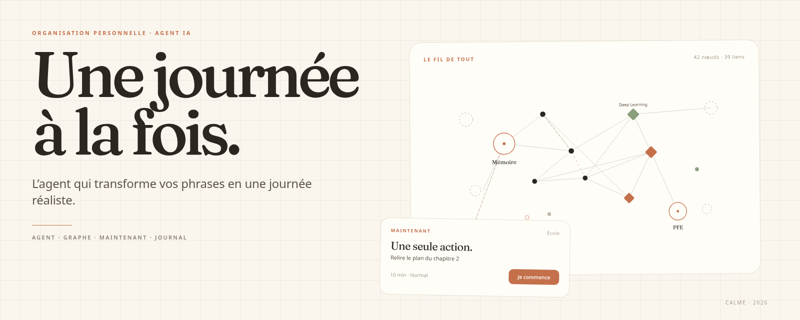
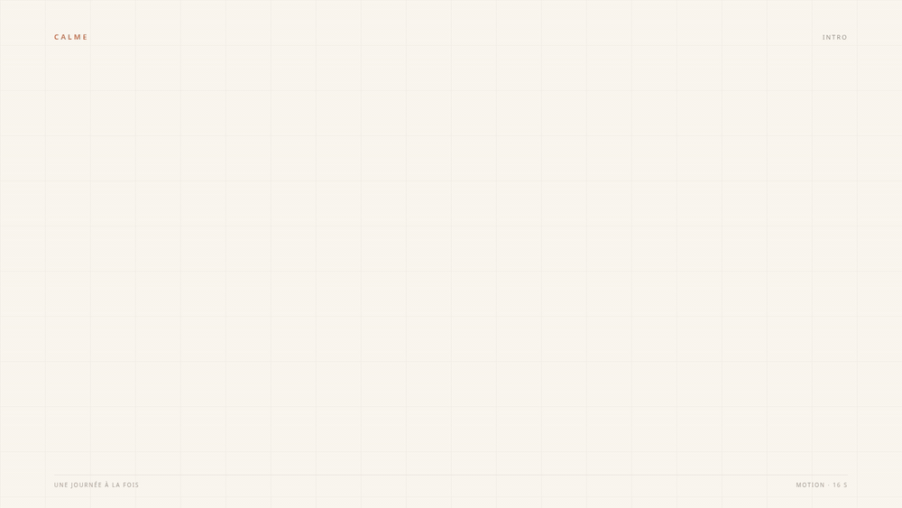
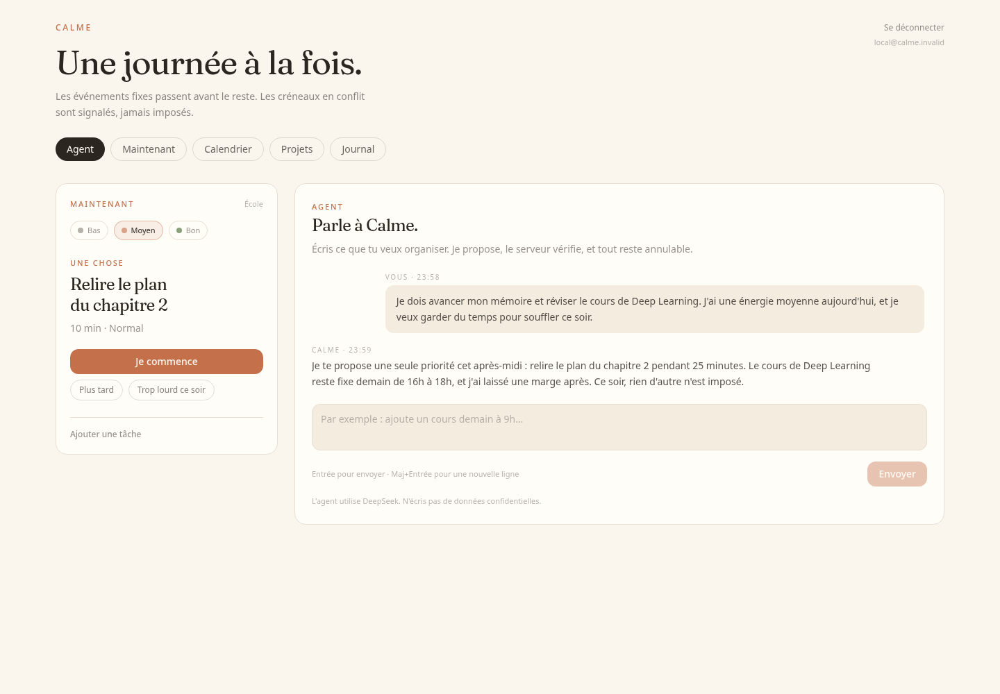
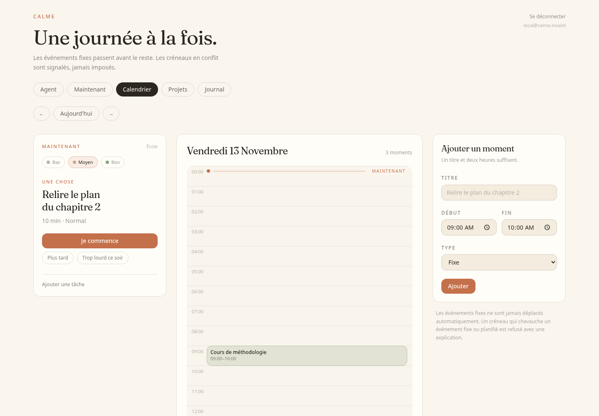
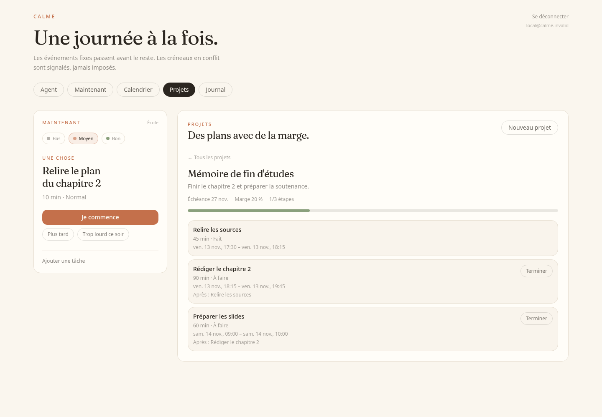
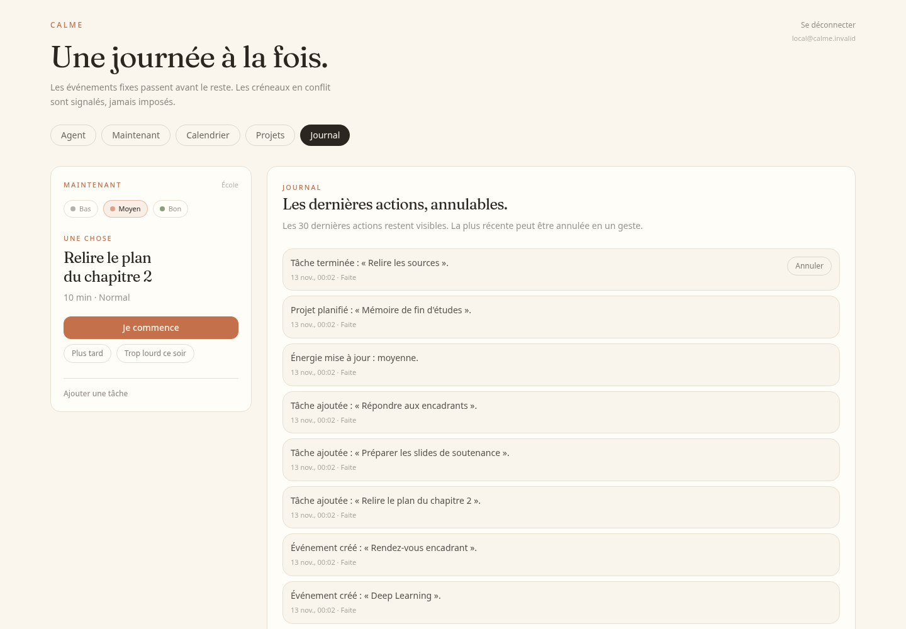
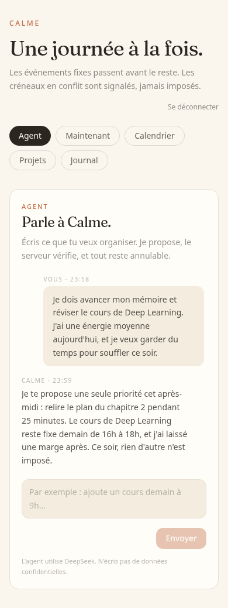
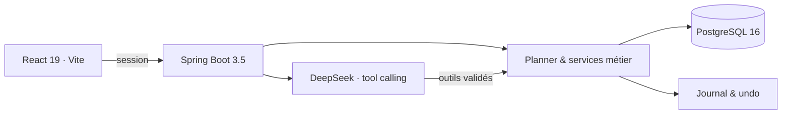
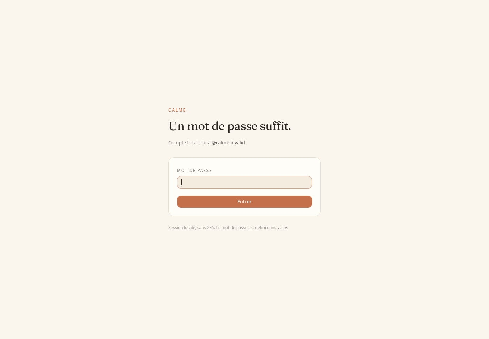

<div align="center">
  
</div>

<div align="center">
  <a href="https://github.com/khadimmbaye0/calme/actions/workflows/ci.yml"></a>
  <a href="https://github.com/khadimmbaye0/calme/actions/workflows/validate-fixtures.yml"></a>
  
  
  
  
  
  
  
</div>

<br>

**Calme** est une application personnelle d'organisation qui transforme une phrase en une journée réaliste.

Un agent central, un calendrier qui protège les engagements, un écran « Maintenant » qui n'affiche qu'une action, et un journal qui rend chaque décision annulable.

> **MVP local fonctionnel** — calendrier, « Maintenant », projets, journal, agent DeepSeek et interface responsive. Le digest, la replanification avancée et l'évaluation des variantes de commandes restent ouverts.

## En mouvement



<p align="center"><sub>Une boucle silencieuse de 16 secondes — <a href="docs/videos/calme-motion.mp4">voir la vidéo MP4</a> · <a href="docs/MOTION.md">storyboard et fabrication</a>.</sub></p>

## Aperçu



<p align="center"><sub>L'agent propose, le serveur valide, le journal garde une trace inversible.</sub></p>

### Calendrier, projets, journal et mobile

| Calendrier | Projets |
|:---:|:---:|
|  |  |
| **Journal** | **Mobile** |
|  |  |

<p align="center"><sub>Captures réalisées avec un jeu de données de démonstration.</sub></p>

## Ce que fait Calme

### Agent central
Parle naturellement : « ajoute un cours demain de 9h à 10h », « qu'est-ce que je fais maintenant ? », « planifie mon mémoire ». L'agent appelle des outils, le backend vérifie, puis l'action est journalisée.

### Calendrier
Vue jour, événements fixes, planifiés et disponibilités. Les conflits sont signalés avant écriture ; les événements fixes ne sont jamais déplacés silencieusement.

### Maintenant
Une seule action, avec une durée maximale de 25 minutes et un titre de 80 caractères. L'énergie se déclare en un geste ; en énergie basse, les tâches non critiques sont reportées.

### Projets
Objectif, échéance, étapes, dépendances validées en DAG, buffer de 20 % minimum et planification dans les créneaux libres. La progression se met à jour à chaque étape terminée.

### Journal et contrôle
Les 30 dernières actions sont visibles, expliquées en une phrase et annulables. Une suppression d'événement ou un plan de plus de 10 éléments demande une confirmation.

### Interface
Papier chaud, titres Fraunces, cartes filaires et aucune animation décorative. Le chat, les formulaires et les listes restent utilisables de 320 px au desktop.

## Architecture



Le LLM ne touche jamais la base. Il propose des appels d'outils ; le backend applique les règles de conflit, de capacité, de dépendances et de confirmation, puis journalise l'action et son inverse.

| Couche | Choix |
|---|---|
| Frontend | React 19, Vite 8, TypeScript 5.9, Tailwind CSS 4, Fraunces |
| Backend | Spring Boot 3.5, Java 21, Spring Security, Spring Data JPA, Flyway |
| Données | PostgreSQL 16, Testcontainers pour les tests |
| Agent | DeepSeek tool calling, mode `simulated` sans réseau |
| Déploiement | Docker Compose, Nginx, healthchecks |

## Démarrage rapide

```bash
git clone https://github.com/khadimmbaye0/calme.git
cd calme
./scripts/up.sh
```

Le script crée `.env` si nécessaire, génère les secrets locaux, construit la pile, attend le healthcheck et affiche l'URL ainsi que le mot de passe Calme à la première génération.

Ouvrir **<http://localhost:5173>**. Compte local : `local@calme.invalid`.

```bash
make up          # équivalent
docker compose down
docker compose down -v   # supprime aussi les données locales
```

Seul le port frontend est publié ; PostgreSQL et Spring restent sur le réseau Compose. Le port `FRONTEND_PORT` vaut `5173` par défaut.

<details>
<summary>Configuration manuelle et développement</summary>

```bash
cp .env.example .env
# renseigner POSTGRES_PASSWORD et CALME_AUTH_PASSWORD
docker compose up --build -d
```

Pour lancer PostgreSQL depuis l'hôte :

```bash
docker compose -f compose.yaml -f compose.dev.yaml up -d db
set -a && source .env && set +a
cd backend && mvn spring-boot:run
```

Frontend en développement :

```bash
cd frontend
npm ci
npm run dev
```

L'API détaillée et les exemples `curl` sont dans [`docs/API.md`](docs/API.md).

</details>

<details>
<summary>Voir l'écran de connexion</summary>



</details>

## Agent et DeepSeek

L'agent est accessible par l'onglet **Agent**, sélectionné par défaut. Il utilise le tool calling DeepSeek : le modèle propose, le backend décide.

| Domaine | Outils |
|---|---|
| Calendrier | `calendar_list` · `calendar_create` · `calendar_update` · `calendar_delete` |
| Tâches | `task_list` · `task_create` · `task_start` · `task_complete` · `task_defer` |
| Projets | `project_list` · `project_plan` |
| Énergie / Maintenant | `energy_set` · `now_get` |
| Journal | `journal_list` · `journal_undo` |

```text
Vous  ·  Ajoute un cours demain de 9h à 10h.
Calme ·  C'est ajouté. Je te propose de garder la matinée libre après.
```

Une suppression d'événement est toujours confirmée. Un plan de projet qui touche plus de 10 éléments aussi. Le backend ne valide l'action qu'après confirmation et la journalise avec son inverse.

### Activer DeepSeek

Sans clé, l'application démarre en mode `simulated` et ne fait aucun appel réseau. Pour le mode réel, dans `.env` :

```bash
DEEPSEEK_API_KEY=<votre-clé>
CALME_LLM_MODE=deepseek
DEEPSEEK_MODEL=deepseek-flash
```

La clé reste dans `.env`, ignoré par Git. Le contrat complet est dans [`docs/AGENT_CONTRACT.md`](docs/AGENT_CONTRACT.md).

## Sécurité et données

- Session locale, mot de passe BCrypt, cookie `HttpOnly` et `SameSite=Strict`.
- CSRF désactivé pour cette application locale non exposée ; à revoir avant toute mise en ligne.
- Pas de 2FA, pas de TLS, pas de sauvegarde automatique : ce n'est pas encore un déploiement de production.
- Les secrets restent dans `.env` (ignoré, mode `600`) et ne sont jamais intégrés aux images.
- En mode DeepSeek, le message, la date, le bloc, l'énergie et les données nécessaires aux outils transitent par l'API. Pas de mot de passe, secret ou donnée d'entreprise.
- Le mode `simulated` reste disponible pour développer sans réseau.

## Tests et qualité

| Suite | Commande | Résultat |
|---|---|---|
| Backend | `cd backend && mvn test` | **57 tests** |
| Frontend | `cd frontend && npm test` | **28 tests** |
| Build | `cd frontend && npm run build` | TypeScript + Vite |
| Fixtures | `python3 scripts/validate_fixtures.py` | Contrat et fixtures valides |

Les tests backend utilisent Testcontainers PostgreSQL ; les tests frontend Vitest et Testing Library. La CI vérifie chaque pull request, ainsi que GitGuardian.

## Structure

```text
backend/src/main/java/com/calme/
  agent/       boucle LLM, outils, confirmations, messages
  calendar/    événements, conflits, disponibilités
  tasks/       tâches et états
  projects/    projets, dépendances, buffer, planification
  planner/     règles de capacité et écran Maintenant
  journal/     actions, inverses et undo
  energy/      énergie déclarée
  blocks/      blocs d'alternance
  auth/ user/  session locale et compte unique

frontend/src/
  components/  AgentPanel, CalendarScreen, NowPanel, Projects, Journal
  api/         client typé
  lib/         dates et helpers

docs/          spec, décisions, contrat agent, API, design
scripts/       up.sh, validate_fixtures.py
compose.yaml
```

## Roadmap

- [x] Socle Spring Boot, React et PostgreSQL
- [x] Authentification locale par session
- [x] Calendrier manuel et vue jour
- [x] Écran Maintenant et planner énergie
- [x] Projets, dépendances et buffer
- [x] Journal et annulation
- [x] Agent conversationnel DeepSeek
- [x] Interface minimaliste et responsive
- [x] Déploiement en une commande
- [ ] Digest quotidien
- [ ] Replanification et édition avancée des projets
- [ ] Import/édition des blocs d'alternance
- [ ] Évaluation des 20 variantes de commandes
- [ ] Rate limiting de l'agent et sauvegardes

## Documentation

| Document | Contenu |
|---|---|
| [`docs/PRODUCT_SPEC.md`](docs/PRODUCT_SPEC.md) | Spécification produit et périmètre MVP |
| [`docs/ACCEPTANCE.md`](docs/ACCEPTANCE.md) | Critères d'acceptation |
| [`docs/AGENT_CONTRACT.md`](docs/AGENT_CONTRACT.md) | Contrat de l'agent et outils |
| [`docs/API.md`](docs/API.md) | Exemples d'API |
| [`docs/DECISIONS.md`](docs/DECISIONS.md) | Décisions prises |
| [`docs/PLAN.md`](docs/PLAN.md) | Plan de livraison |
| [`docs/QUESTIONS.md`](docs/QUESTIONS.md) | Questions encore ouvertes |
| [`docs/DESIGN_TOKENS.md`](docs/DESIGN_TOKENS.md) | Palette, typographie et règles visuelles |

<div align="center">
  <sub>Calme — projet personnel. Les captures utilisent des données de démonstration.</sub>
</div>
