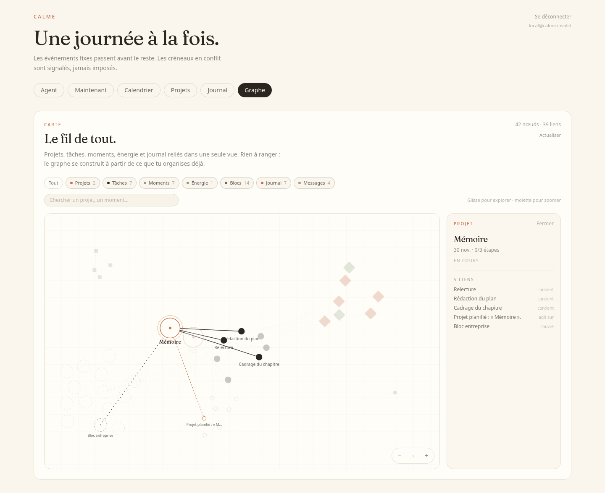

# Graphe de connaissance

## Intention

Le graphe est une **carte en lecture seule** de ce que Calme organise déjà : projets, tâches, dépendances, moments, énergie, blocs d'alternance, actions du journal et messages de l'agent.

Il répond à une demande explicite de l'utilisateur, comme extension du cerveau d'**organisation** — pas comme une base de notes ou de documents. Aucune entité, aucun texte et aucune écriture ne sont ajoutés par le graphe.



## API

`GET /api/graph` exige la session locale et renvoie :

```json
{
  "nodes": [
    {
      "id": "project:1",
      "type": "PROJECT",
      "label": "Mémoire",
      "subtitle": "30 nov. · 1/3 étapes",
      "status": "ACTIVE",
      "weight": 3.4
    }
  ],
  "edges": [
    {
      "id": "project:1|task:1|CONTAINS",
      "source": "project:1",
      "target": "task:1",
      "type": "CONTAINS",
      "label": "contient"
    }
  ]
}
```

### Nœuds

| Type | Contenu |
|---|---|
| `PROJECT` | Projet, échéance, étapes terminées |
| `TASK` | Tâche, estimation, échéance, état |
| `EVENT` | Moment, date, plage horaire, type |
| `ENERGY` | Dernier niveau d'énergie par date |
| `BLOCK` | Bloc école ou entreprise |
| `ACTION` | Action annulable du journal |
| `MESSAGE` | Message récent de la conversation |

### Relations

| Type | Sens |
|---|---|
| `CONTAINS` | Un projet contient une tâche |
| `DEPENDS_ON` | Une tâche dépend d'une autre |
| `SCHEDULED_FOR` | Un moment planifie une tâche |
| `ACTED_ON` | Une action du journal agit sur une entité |
| `DEFERRED` | Une baisse d'énergie a reporté une tâche |
| `COVERS` | Un bloc couvre une date, un moment ou un projet |
| `FOLLOWS` | Deux messages consécutifs de la conversation |

## Limites et vie privée

- Lecture seule : `GET` uniquement, aucun outil de l'agent ne peut modifier le graphe.
- Données filtrées par l'utilisateur courant ; les autres comptes ne sont jamais exposés.
- Volumes bornés pour rester lisible : 150 tâches, 80 événements, 30 énergies, 30 actions, 20 messages, tous les projets et les 14 blocs.
- Le graphe n'est pas envoyé au LLM.
- Les captures et la démonstration utilisent uniquement les données de démonstration.

## Interface

- Filtres par famille, compteur de nœuds et de liens, recherche locale.
- Zoom à la molette ou avec les boutons, déplacement au glisser, recentrage.
- Glisser un nœud pour l'explorer ; cliquer pour ouvrir ses liens.
- Panneau de détail : type, état, date et connexions.
- Aucune animation décorative : le graphe se pose une fois et reste stable, conformément aux tokens visuels.

## Tests

- `GraphApiTests` : nœuds et arêtes des projets, tâches, dépendances, moments, actions, énergie, blocs et messages ; réponse vide sans écriture.
- `graphLayout.test.ts` : positions déterministes, limites, distances minimales.
- `KnowledgeGraphPanel.test.tsx` : rendu, statistiques, détail, filtres, erreur et état vide.
